# BugBuster Pipeline Workflow Diagram

BugBuster is a Nextflow DSL2 pipeline for microbial metagenomics: read QC and host
decontamination, taxonomic profiling, assembly, binning, read-, contig- and bin-level
antimicrobial resistance gene (ARG) prediction, functional annotation and a run-level
summary report. This page shows how the stages connect and which parameter switches each
one on. The one-figure overview is [`images/bugbuster_overview.svg`](images/bugbuster_overview.svg);
parameters are described in [`parameters.md`](parameters.md) and the outputs in
[`manual.md`, section 8](manual.md#8-output-structure).

**How to read the diagrams.** Every box is a process or subworkflow named as in `main.nf`
(nf-core modules under their import alias, e.g. `NFCORE_SAMTOOLS_INDEX`). An edge label is
the parameter condition under which the next step runs, written as in `main.nf`. Boxes with
a solid green border run with the default parameters; boxes with a dashed border are
optional and need a parameter.

`tests/bin/test_workflow_diagram.sh` (run in CI) fails when a process or subworkflow that
`main.nf` or a subworkflow includes is not named on this page.

---

## Main workflow

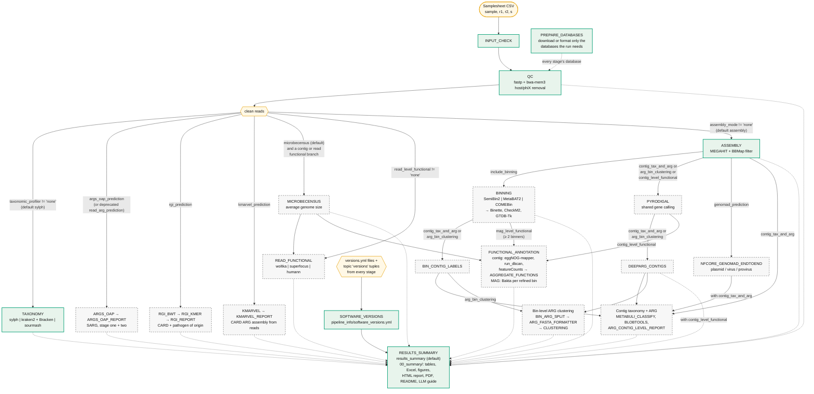

`MICROBECENSUS` runs once per sample when `microbecensus` (default `true`) is on and either
`contig_level_functional` (with an assembly) or `read_level_functional != 'none'` is set; both
functional branches read its output. `SOFTWARE_VERSIONS` always runs; `RESULTS_SUMMARY`
(default on) waits for it because it reads `software_versions.yml`.

---

## Parameter gates

Each stage runs under the condition below, exactly as `main.nf` (and, inside a stage, the
subworkflow) tests it. Launch checks stop a run whose switches contradict each other.

| Stage | Runs when | Launch check |
|-------|-----------|--------------|
| `INPUT_CHECK`, `PREPARE_DATABASES`, `QC`, `SOFTWARE_VERSIONS` | always | — |
| `QC`: fastp + decontamination | `quality_control` (default `true`); otherwise `COUNT_READS` only | — |
| `TAXONOMY` | `taxonomic_profiler != 'none'` (default `sylph`) | `custom_sylph_db` and `custom_sylph_taxonomy` given together |
| `ARGS_OAP`, `ARGS_OAP_REPORT` | `args_oap_prediction` or `read_arg_prediction` (deprecated alias, with a warning) | — |
| `RGI_BWT`, `RGI_REPORT` | `rgi_prediction` | — |
| `RGI_KMER` | `rgi_prediction` and (`custom_rgi_card_db` with the k-mer files, or `rgi_include_wildcard`, default `true`) | — |
| `KMARVEL`, `KMARVEL_REPORT` | `kmarvel_prediction` | — |
| `ASSEMBLY` | `assembly_mode != 'none'` (default `assembly`) | — |
| `BBNORM` | `assembly_read_reduction == 'normalize'` (default `none`) | needs an assembly |
| Reads → contigs alignment | `include_binning` or `contig_tax_and_arg` or `contig_level_functional` | — |
| `NFCORE_SAMTOOLS_MERGE` (pooled co-assembly BAM) | `assembly_mode == 'coassembly'` and (`include_binning` or `contig_tax_and_arg`) | — |
| `BINNING` | `include_binning` (and an assembly) | needs an assembly |
| `BINETTE` / `CHECKM2_BATCH` | ≥ 2 `binners` / 1 binner (default `semibin`) | — |
| `PYRODIGAL` | (`contig_tax_and_arg` or `arg_bin_clustering` or `contig_level_functional`) and an assembly | — |
| `DEEPARG_CONTIGS` | (`contig_tax_and_arg` or `arg_bin_clustering`) and an assembly | — |
| `BIN_CONTIG_LABELS` | `include_binning` and (`contig_tax_and_arg` or `arg_bin_clustering`) | — |
| `NFCORE_GENOMAD_ENDTOEND` | `genomad_prediction` and an assembly (assemblies without contigs skipped) | needs an assembly |
| `DEEPARG_CONTIGS` hits in the summary (`.mapping.ARG`, ARG gene abundance) | `DEEPARG_CONTIGS` runs and `contig_level_functional` | — |
| Contig taxonomy + ARG (`METABULI_CLASSIFY` … `ARG_BLOBPLOT`) | `contig_tax_and_arg` and an assembly | needs an assembly |
| Bin-level ARG clustering | `arg_bin_clustering` and `include_binning` | `arg_bin_clustering` needs `include_binning` |
| `MICROBECENSUS` | `microbecensus` (default `true`) and (`contig_level_functional` with an assembly, or `read_level_functional != 'none'`) | — |
| `FUNCTIONAL_ANNOTATION` | (`contig_level_functional` or `mag_level_functional`) and an assembly | `contig_level_functional` needs an assembly; `mag_level_functional` needs `include_binning` and ≥ 2 `binners` |
| `RUN_DBCAN` | `contig_level_functional` and `functional_cazy` (default `true`) | — |
| `READ_FUNCTIONAL` | `read_level_functional != 'none'` (default `none`) | value in `woltka`, `superfocus`, `humann`, `none` |
| `RESULTS_SUMMARY` | `results_summary` (default `true`) | `summary_group_by` / `summary_order_by` need `sample_metadata` |

---

## Stage diagrams

### 1. INPUT_CHECK

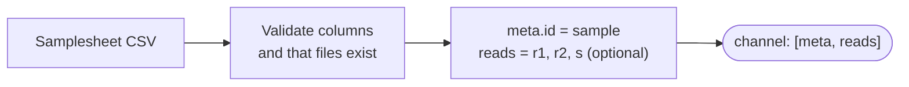

### 2. PREPARE_DATABASES

Only the databases of the enabled stages are prepared. Every database has a `--custom_*`
parameter that bypasses its process and uses the given path in place. Builds from the
registry (`config/databases.config`) are kept with `storeDir` in
`<databases_dir>/<database>/<registry key>/`, so a later run with the same `databases_dir`
skips them; builds from the user's own files keep a `publishDir` copy instead.

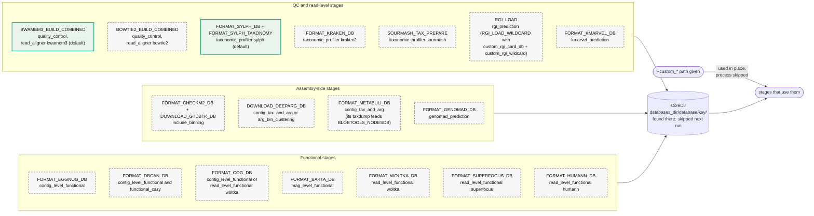

Exceptions to the storeDir rule: the decontamination index built from
`--custom_host_fasta` / `--custom_phiX_fasta`, `RGI_LOAD_WILDCARD` and `SOURMASH_TAX_PREPARE`
on a custom lineages file are rebuilt each run and published to `databases_dir` for reuse
through their `--custom_*` option.

### 3. QC

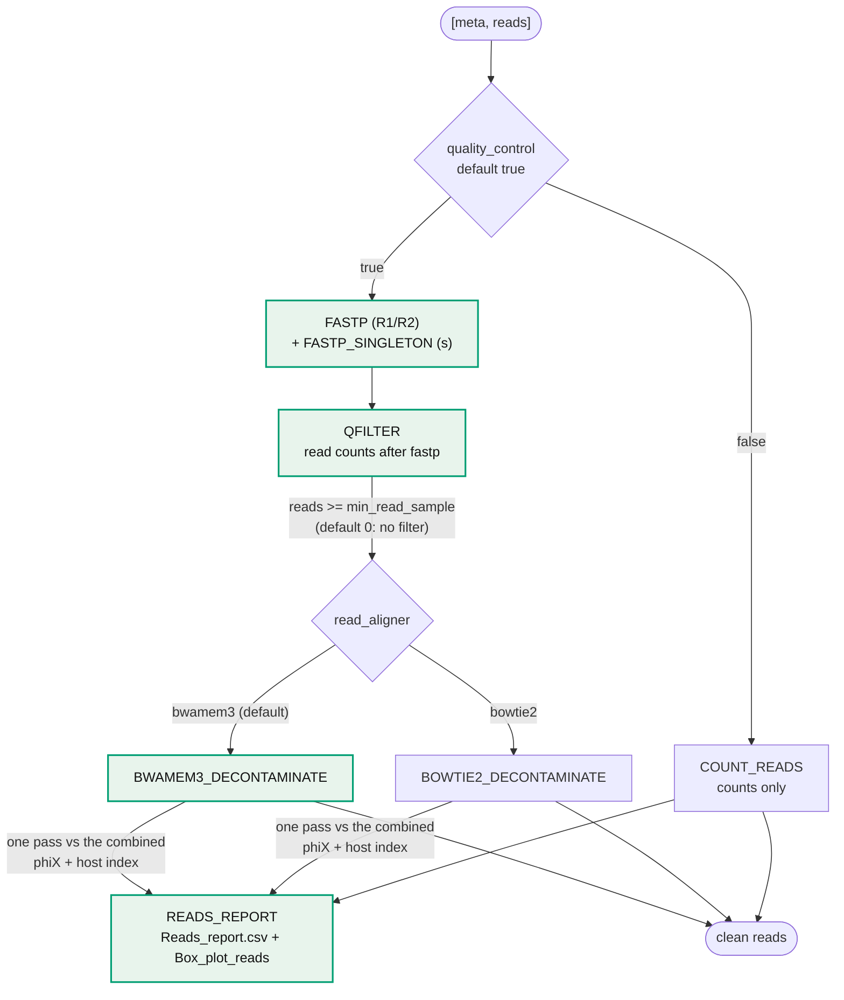

### 4. TAXONOMY

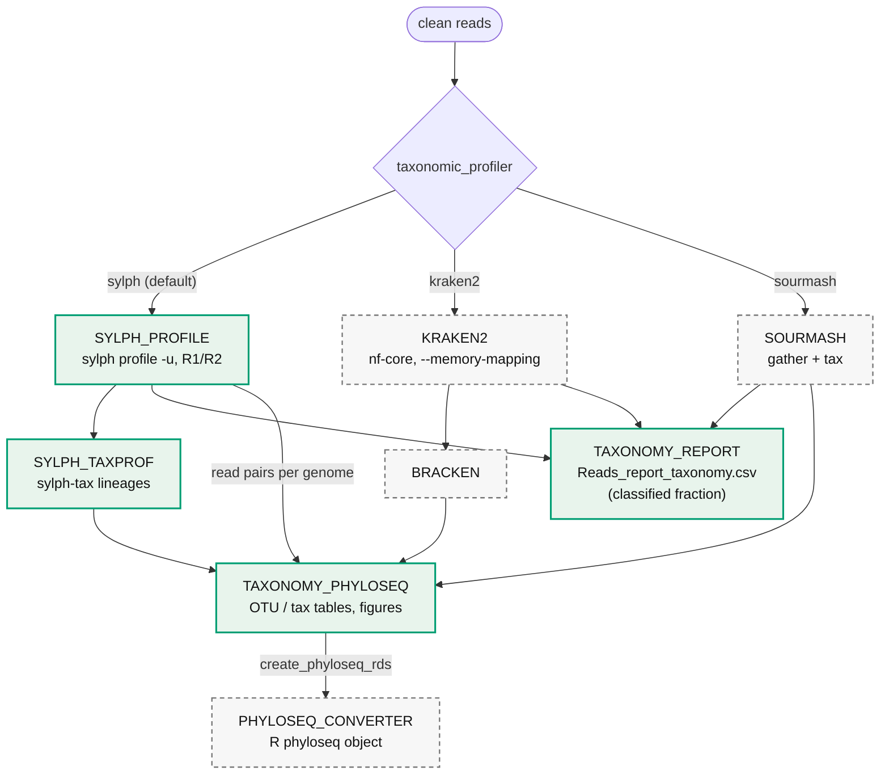

### 5. Read-level ARG prediction

Three independent switches (no subworkflow; wired in `main.nf`). ARGs-OAP is reported against
SARG, apart from the two CARD methods, which the summary compares.

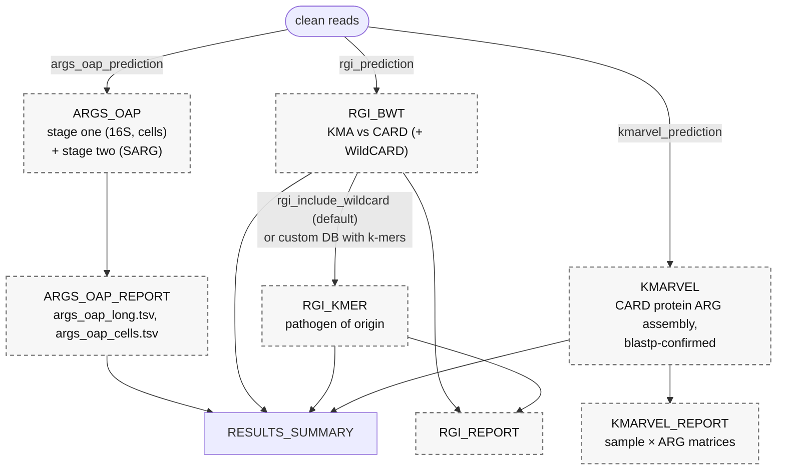

### 6. ASSEMBLY

MEGAHIT runs per sample (`assembly`, default) or once on the pooled reads (`coassembly`).
BBNorm, when selected, reduces only MEGAHIT's input: BBMap, the alignments and everything
downstream use the full reads.

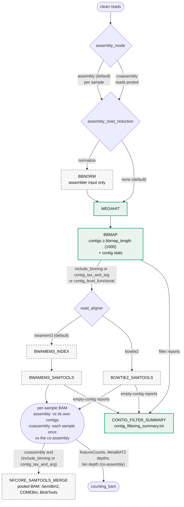

**Outputs:** `contigs_meta` (`[meta, contigs]`), `bam` (`[meta, contigs, bam]`; the pooled
BAM under co-assembly), `bam_meta`, `counting_bam` (one BAM per sample in both modes), BBMap
`*_contig.stats` and `contig_filtering_summary.txt` (both read by `RESULTS_SUMMARY`).

### 7. BINNING

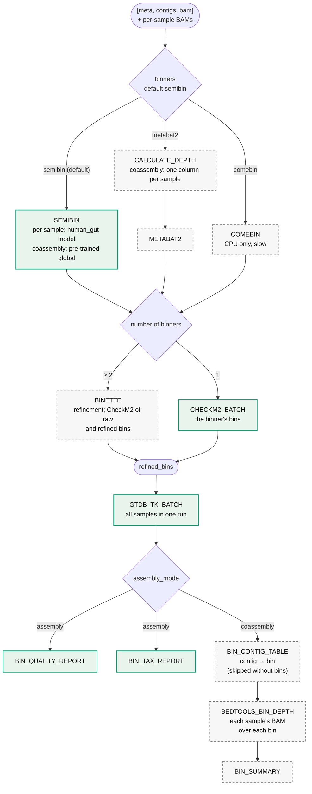

The whole subworkflow needs `include_binning` (default `false`); the green boxes are what a
binning run does with the default `binners`. Binette keeps bins at `bin_min_completeness` 50
and `bin_max_contamination` 10. **Outputs:** `refined_bins`, `gtdbtk` (bac120/ar53
summaries), `refined_quality` (CheckM2 of the refined bins), `bin_depth` (co-assembly).

### 8. Contig taxonomy, contig ARGs and geNomad

One Pyrodigal pass per assembly (`PYRODIGAL`, nf-core) feeds DeepARG, the bin-level split and
the functional branch. DeepARG runs once per assembly; its hits give the contig table and,
split by bin, the bin-level ARGs.

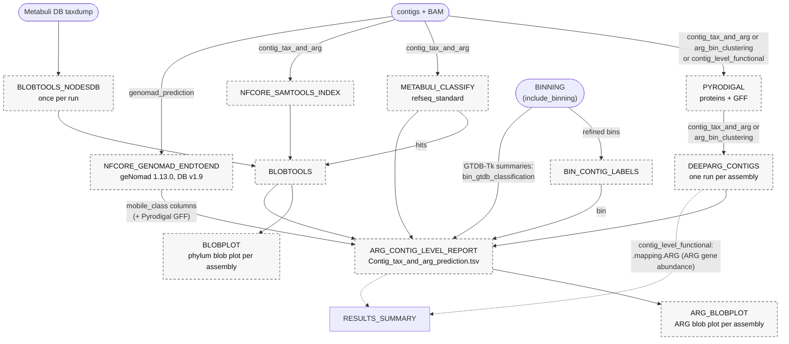

`METABULI_CLASSIFY` through `ARG_BLOBPLOT` need `contig_tax_and_arg`; geNomad runs on its own
with `genomad_prediction`, and adds its columns to the contig table only when
`contig_tax_and_arg` is on too. `bin/blobtools_nodes_fix.sh` renames NCBI's `domain` rank to
`superkingdom` for BlobTools.

### 9. Bin-level ARG clustering

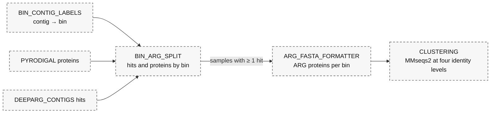

Runs with `arg_bin_clustering` and `include_binning` (a launch check requires both).

### 10. FUNCTIONAL_ANNOTATION

Two independent branches. Both need an assembly; the MAG branch also needs binning with ≥ 2
binners (Bakta annotates only Binette's quality-filtered bins).

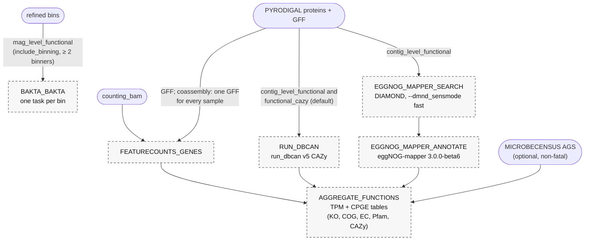

### 11. READ_FUNCTIONAL

One backend per run, on the clean reads; needs no assembly. Its `read_*` tables are reported
apart from the contig branch and never merged with it.

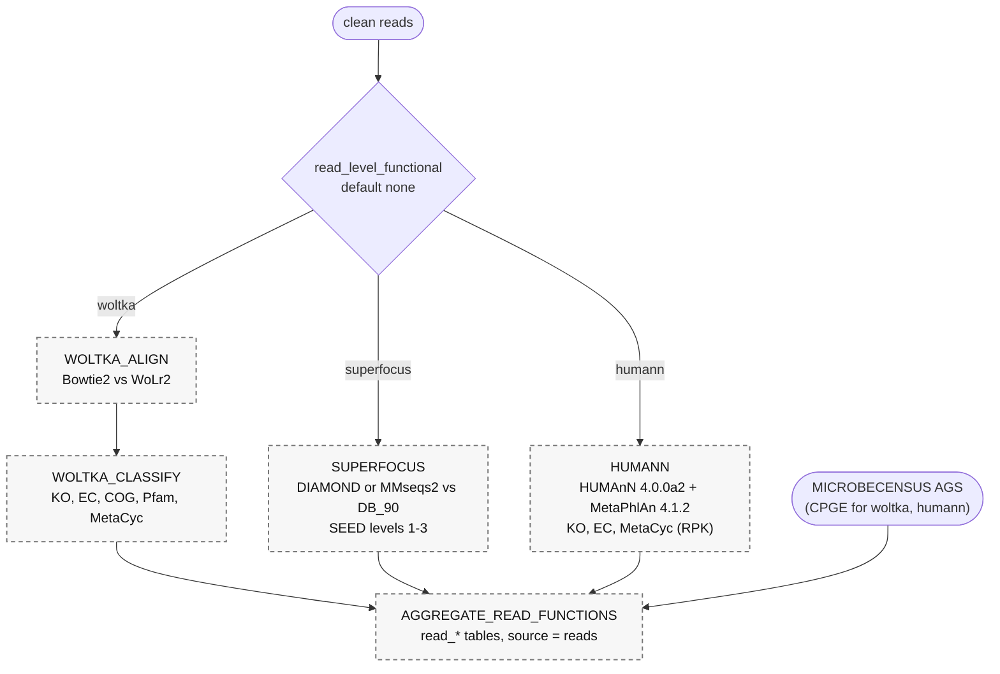

### 12. SOFTWARE_VERSIONS and RESULTS_SUMMARY

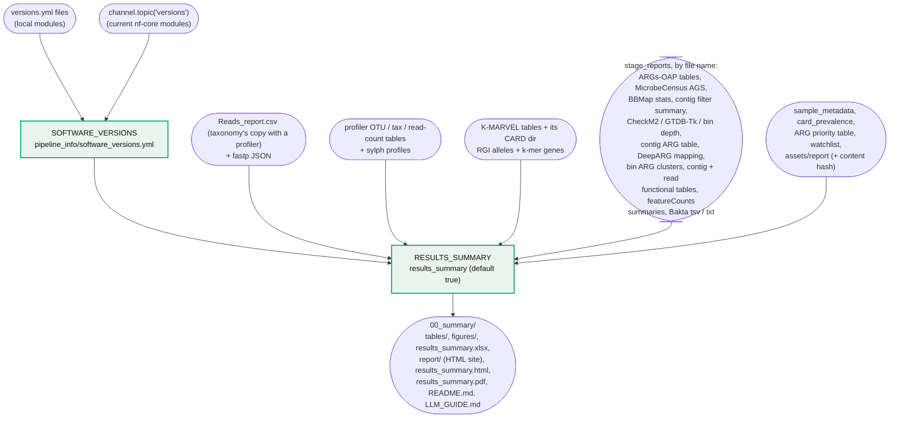

The stage inputs are optional: a stage that did not run gives an empty list, and the summary
leaves its section out. The reads report, `software_versions.yml`, the ARG priority table, the
watchlist and `assets/report` are always given (the two tables default to files in `assets/`). The same script (`bin/results_summary.py`) also merges several finished
results directories outside the pipeline (manual, Example 13).

---

## Module reference

### Subworkflows
| Subworkflow | Description |
|-------------|-------------|
| `INPUT_CHECK` | Validate the samplesheet and build `[meta, reads]` |
| `PREPARE_DATABASES` | Download or format the databases the run needs (storeDir, keyed by registry key) |
| `QC` | fastp, read-count filter, single-pass phiX + host removal |
| `TAXONOMY` | Read-level profiling with sylph (default), Kraken2 + Bracken or sourmash |
| `ASSEMBLY` | MEGAHIT per sample or co-assembly, BBMap filter, reads → contigs alignment |
| `BINNING` | SemiBin2 / MetaBAT2 / COMEBin, Binette, CheckM2, GTDB-Tk, mode-specific reports |
| `FUNCTIONAL_ANNOTATION` | Contig branch (eggNOG-mapper v3, run_dbcan, featureCounts, TPM/CPGE tables) and MAG branch (Bakta per refined bin) |
| `READ_FUNCTIONAL` | Read-level functional profiling, one backend per run (Woltka, SUPER-FOCUS or HUMAnN) |
| `SOFTWARE_VERSIONS` | `pipeline_info/software_versions.yml` from `versions.yml` files and topic tuples |

### Databases (PREPARE_DATABASES)
| Module | Database |
|--------|----------|
| `BWAMEM3_BUILD_COMBINED` / `BOWTIE2_BUILD_COMBINED` | Combined phiX + host index for the selected `read_aligner` |
| `FORMAT_SYLPH_DB` / `FORMAT_SYLPH_TAXONOMY` | sylph database and sylph-tax metadata of the same release (`sylph_db`, default `gtdb_r232`) |
| `FORMAT_KRAKEN_DB` | Kraken2 database (`kraken2_db`, default `standard-8`) |
| `SOURMASH_TAX_PREPARE` | sourmash lineages → `taxonomy.sqldb` |
| `RGI_LOAD` / `RGI_LOAD_WILDCARD` | CARD (+ WildCARD k-mers) for RGI |
| `FORMAT_KMARVEL_DB` | CARD protein models and BLAST index for K-MARVEL |
| `FORMAT_CHECKM2_DB` / `DOWNLOAD_GTDBTK_DB` | CheckM2 and GTDB-Tk databases |
| `DOWNLOAD_DEEPARG_DB` | DeepARG database |
| `FORMAT_METABULI_DB` | Metabuli database (`metabuli_db`, default `refseq_standard`) with its taxdump |
| `FORMAT_GENOMAD_DB` | geNomad database v1.9 |
| `FORMAT_EGGNOG_DB` / `FORMAT_DBCAN_DB` / `FORMAT_COG_DB` | eggNOG 7, dbCAN, NCBI COG definitions |
| `FORMAT_BAKTA_DB` | Bakta database |
| `FORMAT_WOLTKA_DB` / `FORMAT_SUPERFOCUS_DB` / `FORMAT_HUMANN_DB` | Read functional backends' databases |

### Quality control (QC)
| Module | Description |
|--------|-------------|
| `FASTP` / `FASTP_SINGLETON` | Quality filtering and adapter trimming (nf-core fastp; paired + singleton reads) |
| `QFILTER` | Read counts after fastp; samples below `min_read_sample` are dropped |
| `BWAMEM3_DECONTAMINATE` / `BOWTIE2_DECONTAMINATE` | Single-pass phiX + host removal (bwa-mem3 by default) |
| `COUNT_READS` | Read counting when `quality_control` is false |
| `READS_REPORT` | `Reads_report.csv` and the reads-per-step figure |

### Taxonomic profiling (TAXONOMY)
| Module | Description |
|--------|-------------|
| `SYLPH_PROFILE` / `SYLPH_TAXPROF` | sylph containment-ANI profile (`-u`) and sylph-tax lineages |
| `KRAKEN2` / `BRACKEN` | Kraken2 classification and Bracken abundance (nf-core) |
| `SOURMASH` | sourmash gather + taxonomy |
| `TAXONOMY_REPORT` | Classified fraction added to the read report |
| `TAXONOMY_PHYLOSEQ` / `PHYLOSEQ_CONVERTER` | Phyloseq-style tables and figures; optional R object (`create_phyloseq_rds`) |

### Read-level ARG
| Module | Description |
|--------|-------------|
| `ARGS_OAP` / `ARGS_OAP_REPORT` | ARGs-OAP stage one + two against SARG (copies per cell, per 16S, ppm) and run-level tables |
| `RGI_BWT` / `RGI_KMER` / `RGI_REPORT` | RGI bwt (KMA) against CARD, pathogen-of-origin k-mers, summary report |
| `KMARVEL` / `KMARVEL_REPORT` | K-MARVEL read-level CARD ARG assembly and its matrices |

### Assembly (ASSEMBLY)
| Module | Description |
|--------|-------------|
| `BBNORM` | Optional normalization of MEGAHIT's input (`assembly_read_reduction normalize`) |
| `MEGAHIT` | De novo assembly (per sample or co-assembly) |
| `BBMAP` | Contig length filter (`bbmap_length`, 1000) and contig statistics |
| `BWAMEM3_INDEX` + `BWAMEM3_SAMTOOLS` / `BOWTIE2_SAMTOOLS` | Reads → contigs alignment, per sample (per `read_aligner`) |
| `NFCORE_SAMTOOLS_MERGE` | Pooled co-assembly BAM from the per-sample BAMs |
| `CONTIG_FILTER_SUMMARY` | Samples whose contigs were all filtered out |

### Binning (BINNING)
| Module | Condition | Description |
|--------|-----------|-------------|
| `SEMIBIN` | `semibin` in `binners` (default) | SemiBin2 (pre-trained `global` model under co-assembly) |
| `CALCULATE_DEPTH` + `METABAT2` | `metabat2` in `binners` | Contig depths (one column per sample under co-assembly) and MetaBAT2 |
| `COMEBIN` | `comebin` in `binners` | COMEBin, CPU only |
| `BINETTE` | ≥ 2 binners | Refinement, with CheckM2 of the raw and refined bins |
| `CHECKM2_BATCH` | 1 binner | CheckM2 of the binner's bins |
| `GTDB_TK_BATCH` | always | GTDB-Tk classification of every sample's bins in one run |
| `BIN_QUALITY_REPORT` / `BIN_TAX_REPORT` | `assembly` mode | Quality and taxonomy reports |
| `BIN_CONTIG_TABLE` + `BEDTOOLS_BIN_DEPTH` / `BIN_SUMMARY` | `coassembly` mode | Bin depth per sample from the per-sample BAMs, and the bin summary |

### Contig taxonomy, contig and bin ARGs
| Module | Description |
|--------|-------------|
| `PYRODIGAL` | Shared gene calling on the contigs (nf-core; feeds DeepARG and the functional branch) |
| `DEEPARG_CONTIGS` | DeepARG on an assembly's proteins, one run per assembly |
| `METABULI_CLASSIFY` | Per-contig taxonomy with Metabuli |
| `NFCORE_SAMTOOLS_INDEX` | BAM index for BlobTools |
| `BLOBTOOLS_NODESDB` / `BLOBTOOLS` / `BLOBPLOT` | BlobTools nodesDB (once), tables from Metabuli's hits, phylum blob plot |
| `NFCORE_GENOMAD_ENDTOEND` | geNomad plasmid / virus / provirus calls |
| `BIN_CONTIG_LABELS` | Contig → refined bin (the report adds the bin's GTDB-Tk classification) |
| `ARG_CONTIG_LEVEL_REPORT` / `ARG_BLOBPLOT` | `Contig_tax_and_arg_prediction.tsv` and the ARG blob plot |
| `BIN_ARG_SPLIT` / `ARG_FASTA_FORMATTER` / `CLUSTERING` | DeepARG hits split by bin, ARG proteins per bin, MMseqs2 clusters |

### Functional annotation
| Module | Condition | Description |
|--------|-----------|-------------|
| `MICROBECENSUS` | `microbecensus` and a functional branch | Average genome size and genome equivalents (non-fatal) |
| `EGGNOG_MAPPER_SEARCH` / `EGGNOG_MAPPER_ANNOTATE` | `contig_level_functional` | eggNOG-mapper v3, two stages |
| `RUN_DBCAN` | `contig_level_functional` and `functional_cazy` | run_dbcan v5 CAZy annotation |
| `FEATURECOUNTS_GENES` | `contig_level_functional` | Per-gene read counts, per sample |
| `AGGREGATE_FUNCTIONS` | `contig_level_functional` | Study-level TPM / CPGE tables |
| `BAKTA_BAKTA` | `mag_level_functional` | Bakta per refined bin (nf-core) |
| `WOLTKA_ALIGN` / `WOLTKA_CLASSIFY` | `read_level_functional woltka` | Bowtie2 vs WoLr2, Woltka classification |
| `SUPERFOCUS` | `read_level_functional superfocus` | SUPER-FOCUS vs DB_90 |
| `HUMANN` | `read_level_functional humann` | HUMAnN 4 with MetaPhlAn prescreen |
| `AGGREGATE_READ_FUNCTIONS` | `read_level_functional != 'none'` | Study-level `read_*` tables |

### Run summary
| Module | Description |
|--------|-------------|
| `RESULTS_SUMMARY` | `00_summary/`: tables, Excel workbook, figures, multi-page HTML report, PDF, README and LLM guide |

---

## Output structure

Top level of `--output`; the full tree, with every file, is in
[`manual.md`, section 8](manual.md#8-output-structure).

```
results/
├── pipeline_info/               # Execution report, timeline, trace, DAG, software_versions.yml,
│                                # contig_filtering_summary.txt
├── 00_summary/                  # Run summary (results_summary=true, default): report/ (HTML),
│                                # results_summary.html / .pdf / .xlsx, README.md, LLM_GUIDE.md,
│                                # tables/, figures/
├── clean_reads/                 # Decontaminated reads (only if --store_clean_reads)
├── 01_quality_control/          # fastp reports, Reads_report.csv
├── 02_taxonomy/                 # sylph / kraken2 + bracken / sourmash results, tables,
│                                # phyloseq, figures
├── 03_assembly/                 # per_sample/ or coassembly/: contigs, filtered contigs, stats
├── 04_binning/                  # Raw and refined bins, CheckM2 quality, GTDB-Tk taxonomy,
│                                # coverage and summary (co-assembly)
├── 05_arg_prediction/           # read_level/ (args_oap, rgi, rgi_kmer, kmarvel + summaries),
│                                # contig_level/ (DeepARG, contig ARG table, ARG blob plot),
│                                # bin_level/ (proteins, deeparg, arg_fasta, clustering)
├── 06_contig_taxonomy/          # metabuli/, genomad/, phylum blob plots
└── 07_functional_annotation/    # gene_calling/, eggnog/, dbcan/, gene_abundance/,
                                 # microbecensus/, summary/ (TPM/CPGE + read_* tables),
                                 # reads/ (woltka, superfocus, humann), mags/ (Bakta)
```

Databases go to `--databases_dir` (default `<output>/../databases`), apart from the results.

---

## Execution modes

### Default run
QC (fastp + bwa-mem3 decontamination) → sylph taxonomy → per-sample assembly (MEGAHIT +
BBMap filter) → run summary. Binning, ARG prediction and functional annotation are off by
default; for the full pipeline add their flags, for example
`--include_binning true --binners semibin,metabat2 --args_oap_prediction true --rgi_prediction true --kmarvel_prediction true --contig_tax_and_arg true --contig_level_functional true`.

### QC + taxonomy only
```bash
--assembly_mode none
```

### Assembly + binning
```bash
--taxonomic_profiler none --include_binning true
```

### Co-assembly
```bash
--assembly_mode coassembly
```

### Binning with Binette refinement (≥ 2 binners)
```bash
--include_binning true --binners semibin,metabat2
# or all three (COMEBin is slow on CPU):
--include_binning true --binners semibin,metabat2,comebin
```
